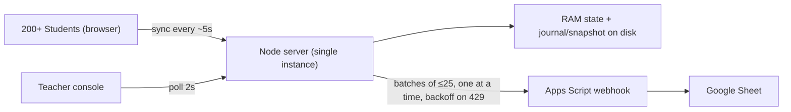

# Deployment Guide

Zero-cost deployment of the English Assessment Portal for 200+ students.



> **Golden rule:** run **exactly ONE instance** of the server. Live state lives in RAM; two instances would give students different views. One small instance is enough: 200 students ≈ 40 tiny requests/second.

---

## 0. Run it locally first (5 minutes)

```bash
npm install
npm start                      # http://localhost:3000   (teacher: /teacher)
npm run loadtest               # spawns server + mock Google Sheets that randomly returns 429, simulates 200 students
```

Teacher login defaults: **User ID `DREXWEB` / Password `DRDREX`** (override with env vars, see below).

---

## 1. Google Sheet + Apps Script (the results database)

1. Create a new Google Sheet (e.g. *"English Assessment Results"*).
2. **Extensions → Apps Script**. Delete the sample code, paste all of [`google-apps-script.js`](google-apps-script.js).
3. Change `SECRET` at the top to a long random string (e.g. 32+ random characters). Keep it – you need the same value on the server as `SHEETS_SECRET`.
4. Select function **`setup`** → **Run** → authorise the permissions. Two tabs appear: `Submissions`, `Violations`.
5. **Deploy → New deployment → ⚙ → Web app**
   - *Execute as:* **Me**
   - *Who has access:* **Anyone**
   - Click **Deploy**, copy the **Web app URL** (`https://script.google.com/macros/s/…/exec`). This is `SHEETS_WEBHOOK_URL`.
6. Quick test: open the URL in a browser – you should see `{"ok":true,"service":"assessment-webhook",…}`.
   Optionally run **`selfTest`** in the editor; a `TEST` row appears (delete it afterwards).
7. If you edit the script later: **Deploy → Manage deployments → ✏ → Version: New version → Deploy** (the URL stays the same).

> "Anyone" only means the URL is reachable; every request must carry your `SECRET`, otherwise it returns `unauthorized`.

---

## 2. Environment variables

| Variable | Required | Purpose |
|---|---|---|
| `ADMIN_USER` | recommended | Teacher user id. Default `DREXWEB` |
| `ADMIN_PASS` | **strongly recommended** | Teacher password. Default `DRDREX` – change it for production, the defaults are guessable |
| `SERVER_SECRET` | **yes** | Any long random string. Signs "session receipts" that let students resume with the same timer / listening plays even if the host wipes the disk and restarts |
| `SHEETS_WEBHOOK_URL` | yes (for Sheets) | Web app URL from step 1 |
| `SHEETS_SECRET` | yes (for Sheets) | Same value as `SECRET` in the Apps Script |
| `DATA_DIR` | if you have a persistent disk | e.g. `/data`. Default `./data` |
| `PORT` | no | Hosts set this automatically |
| `NODE_ENV` | no | `production` |

Generate secrets: `node -e "console.log(require('crypto').randomBytes(24).toString('hex'))"`

---

## 3. Hosting options (all have a free path)

> Free-tier rules change. Check each provider's current limits before exam day, and **always do a dress rehearsal on the real host**.

### Option A – Render (easiest, free web service)

1. Push this folder to a **GitHub** repository (`.gitignore` already excludes `node_modules` and `data`).
2. [render.com](https://render.com) → **New → Web Service** → connect the repo.
3. Settings: **Runtime** Node · **Build** `npm install` · **Start** `npm start` · **Instance type** Free · **Health Check Path** `/api/health`.
4. Add the environment variables from the table above.
5. Deploy. Your URL: `https://<name>.onrender.com`.

Free-tier caveats and how we handle them:

| Caveat | Mitigation |
|---|---|
| Sleeps after ~15 min idle (cold start ≈ 30–60 s) | Create a free [UptimeRobot](https://uptimerobot.com) HTTP monitor on `https://<name>.onrender.com/api/health` every 5 minutes. Open the site yourself 10 minutes before students arrive |
| Filesystem is **ephemeral** (wiped on redeploy/restart) | Signed receipts + students' local copies restore timers/answers automatically; Google Sheets keeps all submitted results. **Turn OFF auto-deploy during exams** and never push during an exam |
| Shared, small CPU/512 MB RAM | The server is tiny (~60–120 MB for 200 students). `/api/health` shows memory + event-loop lag |

### Option B – Fly.io (persistent disk; needs a card, small cost)

```bash
fly launch --no-deploy            # accept defaults, choose a region near your students
fly volumes create data --size 1
fly secrets set ADMIN_PASS=... SERVER_SECRET=... SHEETS_WEBHOOK_URL=... SHEETS_SECRET=...
```
In `fly.toml`:
```toml
[env]
  DATA_DIR = "/data"
[mounts]
  source = "data"
  destination = "/data"
[http_service]
  internal_port = 3000
  force_https = true
  auto_stop_machines = false
  min_machines_running = 1
```
`fly deploy` – then keep it at **one machine** (`fly scale count 1`).

### Option C – Railway
Works the same way as Render (GitHub → New Project → add variables → generate domain). Railway only gives trial credit, so treat it as a backup option.

### Option D – Truly free *and* persistent: a school PC + Cloudflare Tunnel
Best fallback if the school Wi-Fi is the bottleneck or you want zero cloud limits:
```bash
npm install && npm start
# in another terminal (free, no account needed for quick tunnels):
cloudflared tunnel --url http://localhost:3000
```
It prints a public `https://….trycloudflare.com` link. For a permanent link use a named tunnel with your domain. Keep the PC plugged in, on wired Ethernet, with sleep disabled.

---

## 4. Custom domain (optional)

1. Buy/own a domain; put it on **Cloudflare (free plan)** or your registrar's DNS.
2. **Render:** Settings → *Custom Domains* → add `exam.yourschool.org` → create the `CNAME` record Render shows → wait for the green *Verified / certificate issued* badge (HTTPS is automatic).
3. **Fly.io:** `fly certs add exam.yourschool.org` and follow the printed DNS records.
4. In Cloudflare keep the record **DNS only (grey cloud)** unless you know you want proxying.
5. Test: `https://exam.yourschool.org/api/health` → `{"ok":true,…}`.

---

## 5. First-time setup in the Teacher Console

Open `https://<your-url>/teacher` → log in.

1. **Setup & Keys → Exam settings:** title, duration, number of MCQs (≤300), options (A–D or A–E), blanks, listening questions → **Save**.
2. **Marking scheme:** Standard, or Negative (+1 / −0.25 or any decimal) → **Save settings & regrade**.
3. **Master paper:** upload the PDF (≤30 MB) or paste text.
4. **Listening audio:** upload mp3/m4a/wav (≤40 MB).
5. **Answer key builder:** paste `1:A, 2:B, 3:D …` (or CSV, or `ABDC…`) → **Validate** (shows missing/invalid numbers) → **Save key & regrade**. Repeat for Section C. Section B short-answer keys are optional (`1: apple | apples`); essays are graded manually in **Results**.
6. Leave status on **Lobby**. Students can register and wait.
7. When everyone is in: **Go live**. Each student's personal timer starts when *they* press Start.
8. **End & auto-submit all** closes the exam (also happens automatically per student when their time runs out).

> Changing the key or marking scheme later automatically **re-grades all submissions** and updates the Sheet rows (upsert, no duplicates).

---

## 6. Sending the link to students

- Student URL = the site root: `https://<your-url>/` (the teacher console is `/teacher` – do **not** share it).
- Create a short link (bit.ly / your domain) and a **QR code** for projecting in the lab.
- WhatsApp / Classroom template:

> 📝 *English Language Assessment – <Date>, <Time>*
> Open: **https://exam.yourschool.org**
> Use **Google Chrome or Edge on a laptop/desktop** (tablet works; phones are not recommended).
> Enter your **full name, admission number and grade**. Login 10 minutes early and wait in the lobby.
> ⚠ Do not switch tabs/windows – your screen freezes and your teacher is alerted. Plug in your charger and use headphones for the listening section.

- Ask students to close other tabs/apps and disable notifications (Focus Assist / Do Not Disturb) – pop-ups steal window focus and trigger the freeze.

---

## 7. Exam-day run sheet

| When | Action |
|---|---|
| T-1 day | Dress rehearsal on the **real URL** with 5–10 devices; test freeze → warn → unlock, audio 2-play lock, submit, and the Sheet rows |
| T-30 min | Open `/api/health`; check Sheets tab on **System** shows *Configured*; confirm paper/audio/key are saved; **disable auto-deploy** |
| T-15 min | Students join lobby; watch **Registered** count; use *Release session* for anyone stuck on "already active" |
| T-0 | **Go live**. Keep **Live Proctor** open (sound alerts on) |
| During | Unlock frozen students after you verify them; warn/broadcast; grant a replay if audio failed; *+5 min* for tech faults |
| End | **End & auto-submit all** → **Results → Export CSV** (backup) → check Sheets queue = 0 on **System** |
| After | Grade essays in **Results**; **Archive & clear students** before the next batch |
